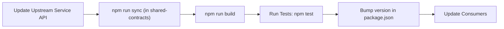

# @nebron/contracts

Single source of truth for API schemas and event contracts across the Nebron polyrepo ecosystem.

---

## 1. What This Repository Is

`shared-contracts` is a centralized contract package (`@nebron/contracts`) containing:
- **OpenAPI 3.1 specifications** for HTTP REST microservices (`auth-service`, `core-api`, `chat-service`, `voice-service`).
- **JSON Schema (draft-07)** event contracts for asynchronous message passing via Redis Streams (`nebron.events`).
- **Generated TypeScript types** via `openapi-typescript` and `json-schema-to-typescript`.
- **Runtime validation** using `zod` schemas and a unified event dispatcher (`parseEvent`).

All microservice backends (`auth-service`, `core-api`, `chat-service`, `voice-service`) and client frontends (`web-frontend`, `mobile-app`, `desktop-app`) depend on this package.

---

## 2. Why It Exists

In a microservice polyrepo architecture, microservices and frontends evolve independently. Without a single contract repository:
- **Type drift occurs silently**: One service changes response fields or event payloads while consumers continue expecting older shapes, causing runtime failures in production.
- **Hand-parsed event payloads fail unpredictably**: Services consuming messages from Redis Streams often rely on informal assumptions rather than validated schemas.
- **Duplicated schema definitions waste effort**: Multiple repos duplicate identical TypeScript interfaces or validation logic.

`@nebron/contracts` solves this by acting as the authoritative schema registry.

---

## 3. Workflow

When an upstream service API or event schema changes:



1. **Modify Upstream API / Event**: Make your changes in the upstream service or in `events/`.
2. **Synchronize Specs**:
   ```bash
   npm run sync
   ```
   This copies updated `openapi.yaml` files from sibling microservices into `openapi/`.
3. **Regenerate & Compile**:
   ```bash
   npm run build
   ```
   This generates TypeScript types into `src/generated/` and compiles to `dist/`.
4. **Run Verification Tests**:
   ```bash
   npm test
   ```
5. **Bump Package Version**: Update `"version"` in `package.json` (e.g. `0.1.0` -> `0.1.1`).
6. **Update Consumers**: In consumer repositories, update the dependency reference and run `npm install`.

---

## 4. Adding a New Event

To introduce a new event type to the Nebron ecosystem:

1. **Create the JSON Schema file**:
   Add `events/<domain>.<entity>.<action>.json` conforming to JSON Schema draft-07:
   ```json
   {
     "$id": "chat.message.sent",
     "type": "object",
     "required": ["messageId", "channelId", "senderId", "sentAt"],
     "properties": {
       "messageId": { "type": "string" },
       "channelId": { "type": "string" },
       "senderId":  { "type": "string" },
       "sentAt":    { "type": "string", "format": "date-time" }
     },
     "additionalProperties": false
   }
   ```

2. **Register in `events/index.json`**:
   Add the event mapping to `events/index.json`:
   ```json
   {
     "auth.user.registered": "./auth.user.registered.json",
     "auth.session.revoked": "./auth.session.revoked.json",
     "core.profile.updated": "./core.profile.updated.json",
     "voice.call.ringing":   "./voice.call.ringing.json",
     "chat.message.sent":    "./chat.message.sent.json"
   }
   ```

3. **Add Zod Schema and Discriminated Union in `src/events.ts`**:
   Define and export the runtime validator and update `EventSchema`:
   ```typescript
   export const ChatMessageSentSchema = z.object({
     messageId: z.string(),
     channelId: z.string(),
     senderId: z.string(),
     sentAt: z.string().datetime(),
   }).strict();
   export type ChatMessageSent = z.infer<typeof ChatMessageSentSchema>;

   // Add to EventSchema discriminated union and NebronEvent type
   ```

4. **Rebuild & Test**:
   ```bash
   npm run build && npm test
   ```

---

## 5. Consuming from a Service

### Installation

Consumers reference `@nebron/contracts` via a local file reference in `package.json`:

```json
{
  "dependencies": {
    "@nebron/contracts": "file:../shared-contracts"
  }
}
```

Run `npm install` inside the consumer repository.

### Consuming Events (e.g. from Redis Stream `nebron.events`)

Every consumer of the `nebron.events` stream must use `parseEvent` — never hand-parse event payloads.

```typescript
import { parseEvent, type NebronEvent } from '@nebron/contracts';

// In your stream consumer loop:
function handleRawMessage(rawMessage: unknown) {
  try {
    const event: NebronEvent = parseEvent(rawMessage);

    switch (event.type) {
      case 'auth.user.registered':
        console.log('User registered:', event.payload.userId, event.payload.email);
        break;

      case 'auth.session.revoked':
        console.log('Session revoked for user:', event.payload.userId, event.payload.reason);
        break;

      case 'core.profile.updated':
        console.log('Profile updated:', event.payload.userId, event.payload.username);
        break;

      case 'voice.call.ringing':
        console.log('Call ringing:', event.payload.callId, event.payload.fromUserId);
        break;
    }
  } catch (error) {
    console.error('Invalid event structure or payload rejected by schema:', error);
  }
}
```

### Consuming API Types

```typescript
import type {
  AuthAPI,
  CoreAPI,
  ApiSuccess,
  ApiError
} from '@nebron/contracts';

// Extract request/response types for endpoints:
type RegisterRequestBody = AuthAPI['/auth/register']['post']['requestBody']['content']['application/json'];
type RegisterResponse200 = AuthAPI['/auth/register']['post']['responses']['200']['content']['application/json'];

type ProfileResponse = ApiSuccess<{
  userId: string;
  username: string;
}>;
```

---

## 6. Currently Registered Events

| Event Type (`$id`) | Schema File | Required Fields | Description |
|---|---|---|---|
| `auth.user.registered` | [`events/auth.user.registered.json`](./events/auth.user.registered.json) | `userId`, `email`, `createdAt` | Emitted when a new user finishes registration in `auth-service`. |
| `auth.session.revoked` | [`events/auth.session.revoked.json`](./events/auth.session.revoked.json) | `userId`, `sessionId`, `reason` | Emitted when a refresh session is revoked (logout, expiry, reuse detection, admin). |
| `core.profile.updated` | [`events/core.profile.updated.json`](./events/core.profile.updated.json) | `userId`, `updatedAt` | Emitted when user profile, preferences, or username are modified in `core-api`. |
| `voice.call.ringing` | [`events/voice.call.ringing.json`](./events/voice.call.ringing.json) | `callId`, `fromUserId`, `toUserId`, `startedAt` | Emitted when a 1-to-1 or room call starts ringing. |

The authoritative registry is tracked in [`events/index.json`](./events/index.json).

---

## 7. Service Endpoints & Network Ports

Refer to [`../infra/docs/ports.md`](../infra/docs/ports.md) for full port allocations and network configurations:

- `auth-service`: `http://localhost:4001`
- `core-api`: `http://localhost:4002`
- `chat-service`: `http://localhost:4003`
- `voice-service`: `http://localhost:4004`
- Redis stream: `redis://localhost:6379` (Stream: `nebron.events`)
- MongoDB: `mongodb://localhost:27017`
